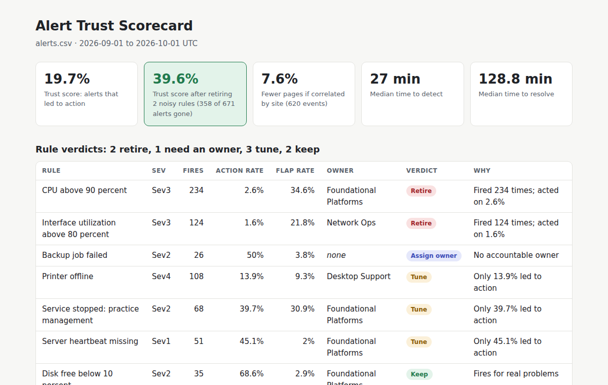
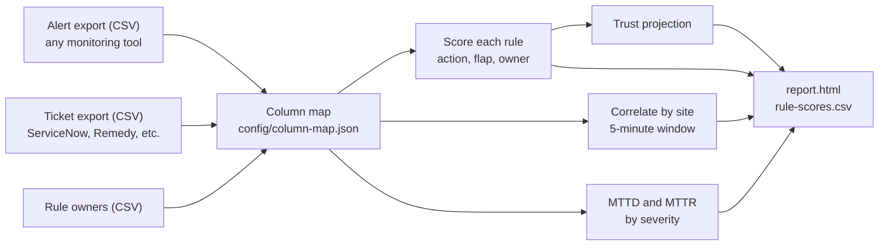

# Alert Trust Scorecard

**Can your team trust its monitoring tool?** This PowerShell module answers that with numbers.
It reads your monitoring tool's alert export and your ticket export, then scores every alert rule
on whether it fires for real problems, whether anyone owns it, and whether anyone acts on it.



*The report above is built from synthetic data (`scripts/New-SampleData.ps1`, seeded): a 25-office fleet over 30 days.*

## What it tells you

| Verdict | Meaning | Rule of thumb (configurable) |
|---|---|---|
| **Retire** | Fires a lot, almost nobody acts on it | 10+ fires, under 10% led to action |
| **Assign owner** | Nobody is accountable for it | No owner in the owners list |
| **Tune** | Useful, but noisy or flapping | Under 50% action, or over 20% flapping |
| **Keep** | Fires for real problems and people act | Everything else |

Plus three fleet-level views:

- **Trust score**: the share of all alerts that led to a real action, and the **projected** score after retiring noisy rules.
- **Site correlation**: alerts at the same office within 5 minutes collapse into one event, so a WAN outage that trips ten rules reads as one page.
- **Response time**: median time to detect (alert to ticket) and time to resolve, by severity.

In the synthetic sample, retiring 2 rules removes 358 of 671 alerts (53%) and doubles the trust score from 19.7% to 39.6%.

## How it works



## Run it

```powershell
# 1. Try it on the synthetic sample
./scripts/New-SampleData.ps1
Import-Module ./src/AlertTrust/AlertTrust.psd1
Invoke-AlertTrustScorecard -AlertPath ./samples/alerts.csv -TicketPath ./samples/tickets.csv `
  -OwnerPath ./samples/owners.csv -ColumnMapPath ./config/column-map.json -OutputDirectory ./out
# open ./out/report.html

# 2. Run it on your own exports: edit the right-hand side of config/column-map.json to match
#    your column names, and list the ticket resolutions that mean "nothing was done".
```

Thresholds are parameters (`-MinFires`, `-RetireBelowPercent`, `-TuneBelowPercent`, `-TuneFlapAbovePercent`,
`-FlapWindowMinutes`, `-CorrelationWindowMinutes`), so a team can agree on its own definition of trusted.

## Design choices

- **Tool-agnostic.** CSV in, so it works with any monitoring and ticketing pair without API credentials. A column map adapts it to each export.
- **Explainable.** Every verdict comes with a plain-language reason. No black-box score.
- **Safe to share.** The HTML report is self-contained, HTML-encodes every value, and works in light and dark mode.

## Tests

11 Pester tests on hand-built fixtures, where every expected number can be checked by hand: verdicts, flap
detection, site correlation, medians, trust projection, custom column maps, threshold overrides, and HTML encoding.
CI runs the linter, the tests, and builds the sample report on every push.

```powershell
Invoke-Pester ./tests -Output Detailed
```

## Rollout

See [docs/rollout-plan.md](docs/rollout-plan.md) for how I would use this to take a monitoring platform from
"not trusted" to "most trusted tool" in phases with measurable exits.

## Roadmap

- API connectors instead of CSV (monitoring platform API, ServiceNow Table API)
- Weekly scheduled run in Azure Automation, with the report posted to a Teams channel
- Trend view: trust score week over week, per team and per rule
- Dependency-aware correlation using CMDB site relationships (WAN, firewall, server)
